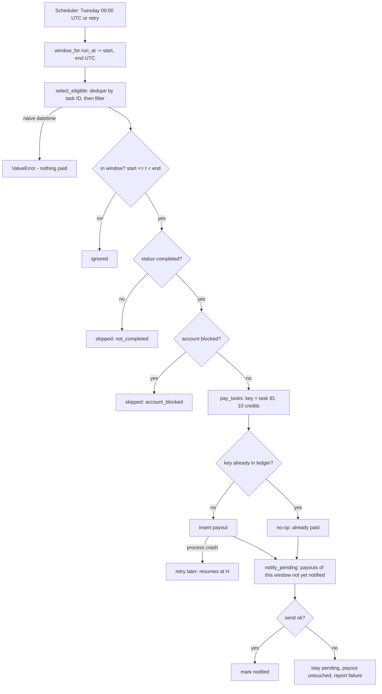

# Flow map

## Failure points and where the rule holds

| Step | What can go wrong | Guard |
|------|-------------------|-------|
| Window | Off-by-one at end, wrong timezone | BR-2, BR-3 |
| Input | Duplicate rows, naive timestamps | BR-3, BR-5 |
| Pay | Crash mid-run, retry, re-run | payout key = task ID (BR-5) |
| Notify | Provider down, crash after send | pending state derived from the ledger (BR-7) |
